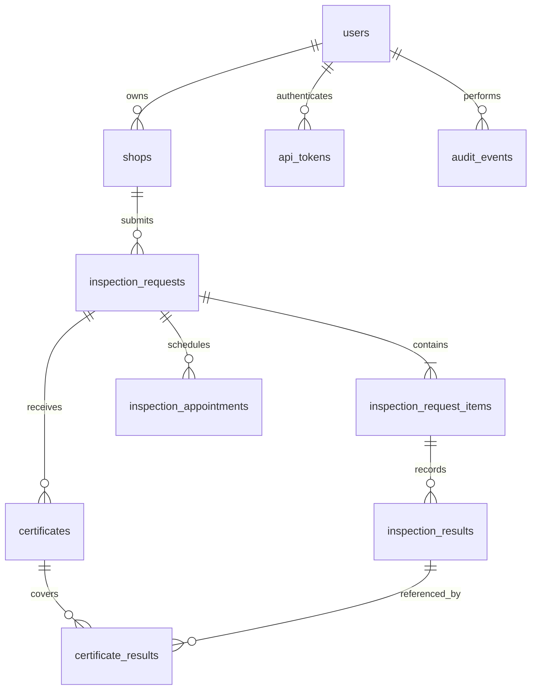

# SafeVege ER diagram (draft)

An admin is a `users` row with `role = 'admin'`. The admin user is also referenced by appointment, result, and certificate records to preserve who performed each action.
